# Explorer — Descubre países del mundo

Primer Examen Parcial de Diseño Web. Implementación del diseño de Figma
**Explorer App — UX/UI Lab 1** como aplicación web responsiva: permite buscar países por
nombre o capital, filtrarlos por región y consultar la ficha de cada uno.

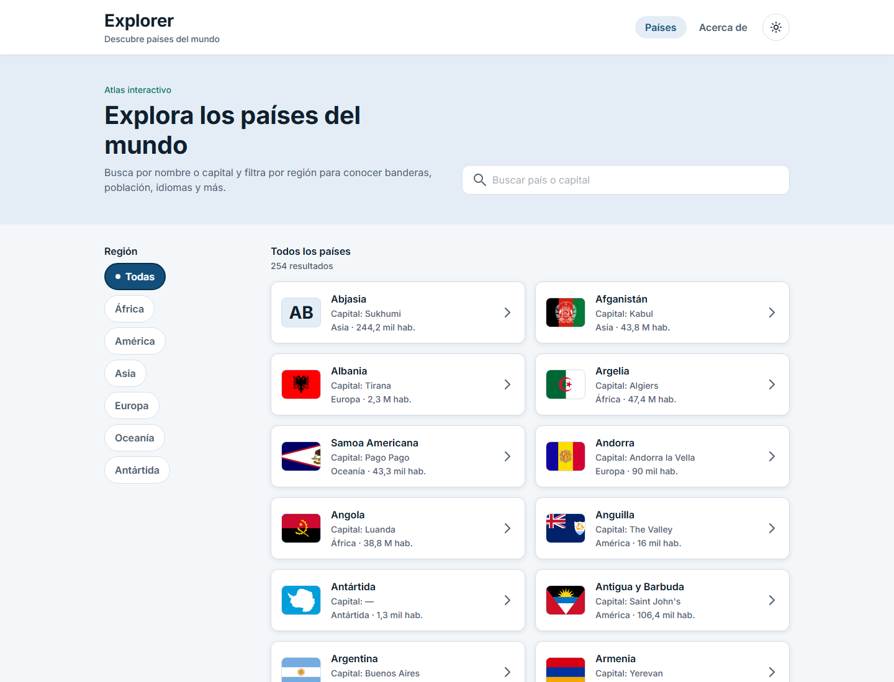

## Tecnologías

| Tecnología | Uso en el proyecto |
| --- | --- |
| [Vite 8](https://vite.dev) | Servidor de desarrollo y build |
| [TypeScript](https://www.typescriptlang.org) | Tipado estricto en todo el código |
| [React 19](https://react.dev) | Componentes de la interfaz |
| [TanStack Start / Router](https://tanstack.com/start) | Rutas por archivos, search params tipados y *server functions* |
| [Tailwind CSS v4](https://tailwindcss.com) | Utility classes y Design Tokens con `@theme` |
| [daisyUI 5](https://daisyui.com) | Componentes base (`btn`, `input`, `alert`, `menu`, `loading`) y temas claro / oscuro propios |
| [REST Countries v5](https://restcountries.com) | API de datos de países |
| [Inter](https://fontsource.org/fonts/inter) | Tipografía del diseño (vía Fontsource) |
| [Lucide](https://lucide.dev) | Íconos de sol y luna del botón de tema |
| [Biome](https://biomejs.dev) | Formato y lint |

> El uso de React, TanStack y daisyUI, así como el consumo de la API, fue autorizado por la docente.

## Requisitos

- [Bun](https://bun.sh) 1.x (o Node.js 20+ con npm)
- Una API key gratuita de REST Countries

## Instalación y ejecución

```bash
git clone https://github.com/user-49333/Explorer-app
cd parcial1
bun install
```

Crea el archivo `.env` a partir del ejemplo y coloca tu API key:

```bash
cp .env.example .env
```

```bash
bun run dev
```

La aplicación queda disponible en http://localhost:3000.

| Script | Descripción |
| --- | --- |
| `bun run dev` | Servidor de desarrollo en el puerto 3000 |
| `bun run build` | Build de producción en `dist/` |
| `bun run preview` | Sirve el build de producción |
| `bun run check` | Formato y lint con Biome |

## Variables de entorno (API key)

La API de REST Countries requiere un token enviado en el header `Authorization: Bearer <token>`.
La key se obtiene en el [dashboard de REST Countries](https://restcountries.com/dashboard).

```env
# .env
RESTCOUNTRIES_API_KEY=tu_api_key_aqui
```

- `.env` está en `.gitignore`, **no se sube al repositorio**. El archivo versionado es `.env.example`.
- La variable **no** lleva el prefijo `VITE_`: las peticiones a la API se hacen dentro de
  *server functions* de TanStack Start (`src/lib/countries.ts`), por lo que la key solo se lee
  en el servidor con `process.env` y nunca llega al navegador.
- El plan gratuito permite hasta 100 países por petición; la app pagina de 24 en 24.

Endpoints utilizados:

| Petición | Uso |
| --- | --- |
| `GET /countries/v5?q=&region=&limit=&offset=` | Listado, búsqueda y filtro por región |
| `GET /countries/v5/codes.alpha_3/{código}` | Ficha de un país |
| `GET /countries/v5/uuid/{uuid}` | Ficha de territorios sin código ISO |

Todas usan `response_fields` para pedir solo los campos que muestra la interfaz.

## Estructura

```
├── docs/
│   ├── capturas/          # Capturas de la implementación (desktop, tablet, mobile; claro y oscuro)
│   └── figma/             # Imágenes de referencia exportadas de Figma
├── src/
│   ├── assets/icons/      # Íconos exportados de Figma (search, chevron, indicador, bandera)
│   ├── components/        # Componentes del sistema de diseño
│   │   ├── BackButton.tsx     # Botón volver
│   │   ├── Button.tsx         # Button (Default / Hover / Active / Disabled)
│   │   ├── Chip.tsx           # Chip filtro (Default / Seleccionado)
│   │   ├── CountryCard.tsx    # Card país
│   │   ├── Flag.tsx           # Bandera
│   │   ├── Footer.tsx
│   │   ├── Header.tsx
│   │   ├── Icon.tsx           # Pinta los íconos de Figma con el color del tema
│   │   ├── SearchBar.tsx      # Barra de búsqueda
│   │   ├── StatusMessage.tsx  # Estados vacío / error / 404
│   │   └── ThemeToggle.tsx    # Botón modo claro / oscuro
│   ├── lib/countries.ts   # Server functions de la API, tipos y formateadores
│   ├── routes/
│   │   ├── __root.tsx         # Documento HTML, header y footer
│   │   ├── index.tsx          # /            listado, búsqueda y filtros
│   │   ├── pais.$code.tsx     # /pais/:code  ficha del país
│   │   └── about.tsx          # /about       tecnologías y paleta de tokens
│   ├── router.tsx
│   └── styles.css         # Tailwind, @theme (Design Tokens) y temas daisyUI claro / oscuro
├── .env.example
└── vite.config.ts
```

## Design Tokens

Los tokens de la colección **Explorer App** de Figma están definidos con `@theme` en
[`src/styles.css`](src/styles.css) y se usan como utility classes de Tailwind:

| Grupo | Tokens | Ejemplo de clase |
| --- | --- | --- |
| Color | `primary`, `primary-hover`, `primary-active`, `secondary`, `background`, `surface`, `surface-subtle`, `text-primary`, `text-secondary`, `text-on-primary`, `border`, `focus`, `disabled-surface`, `disabled-text` | `bg-primary`, `hover:bg-primary-hover`, `text-text-secondary` |
| Espaciado | `xs` 4px, `sm` 8px, `md` 16px, `lg` 24px, `xl` 32px, `2xl` 48px, `control` 48px, `chip` 44px, `card` 88px | `p-md`, `gap-sm`, `h-control`, `min-h-card` |
| Radio | `sm` 8px, `md` 12px, `pill` 999px | `rounded-md`, `rounded-pill` |
| Tipografía | `title`, `display`, `card`, `body`, `button`, `label` (tamaño, interlineado, peso y tracking) | `text-title`, `text-label` |
| Sombra | `header`, `card` | `shadow-header`, `shadow-card` |

El tema de daisyUI `explorer` usa los mismos valores, así los componentes de daisyUI heredan la identidad del diseño.

## Modo claro y oscuro

El botón con el ícono de sol / luna en el header cambia entre los temas de daisyUI `explorer` (claro) y `explorer-dark` (oscuro).

- El modo oscuro **no duplica clases**: en `src/styles.css` el selector `[data-theme="explorer-dark"]` redefine los mismos tokens (`--color-surface`, `--color-text-primary`, `--shadow-card`...) y todas las utility classes cambian solas. Los valores mantienen contraste AA (texto principal 14.6:1, secundario 7.4:1).
- La primera vez se usa la preferencia del sistema operativo; al pulsar el botón la elección se guarda en `localStorage`.
- Un script en el `<head>` aplica el tema antes de pintar la página, así no hay parpadeo al recargar.
- Los íconos exportados de Figma se pintan con máscara CSS (`Icon.tsx`) para que tomen el color del tema.

## Diseño responsive

| | Mobile (< 768px) | Tablet (≥ 768px) | Desktop (≥ 1024px) |
| --- | --- | --- | --- |
| Navegación | Menú desplegable | Enlaces horizontales | Enlaces horizontales + subtítulo |
| Hero | Apilado | Apilado | Texto y buscador en 2 columnas |
| Filtros | Chips con scroll horizontal | Chips en filas | Barra lateral vertical fija |
| Listado | 1 columna | 2 columnas | 2 columnas junto a filtros (3 en ≥ 1536px) |
| Ficha | Bandera arriba, datos en 2 columnas | Bandera lateral fija | Bandera 5/12 y datos 7/12 en 3 columnas |
| Paginación | Botones a ancho completo | Botones compactos | Botones compactos |

| Mobile | Tablet | Desktop |
| --- | --- | --- |
| 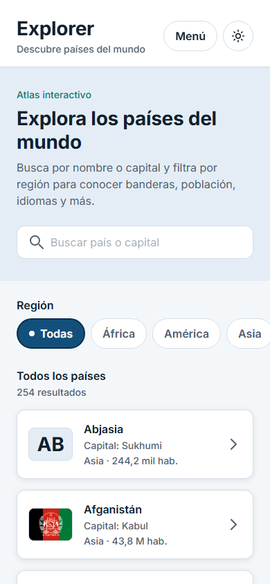 | 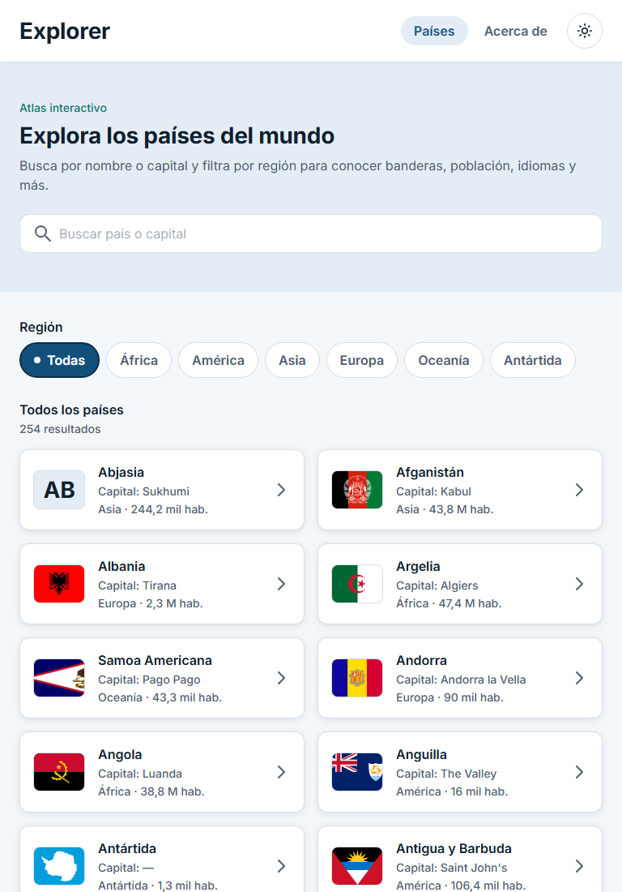 |  |
| 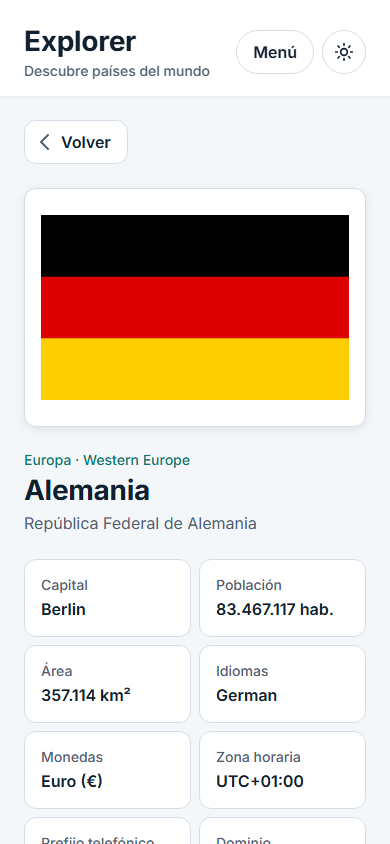 | 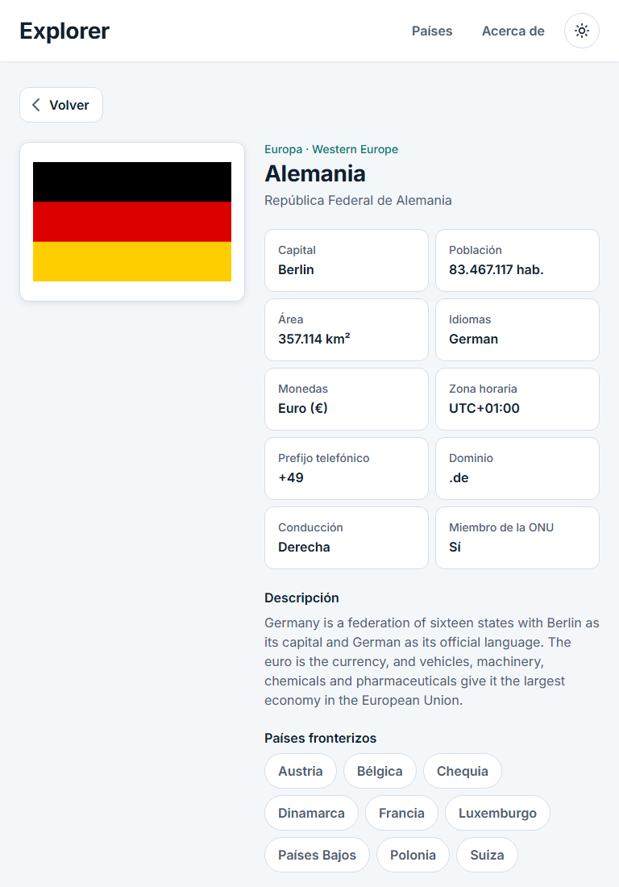 | 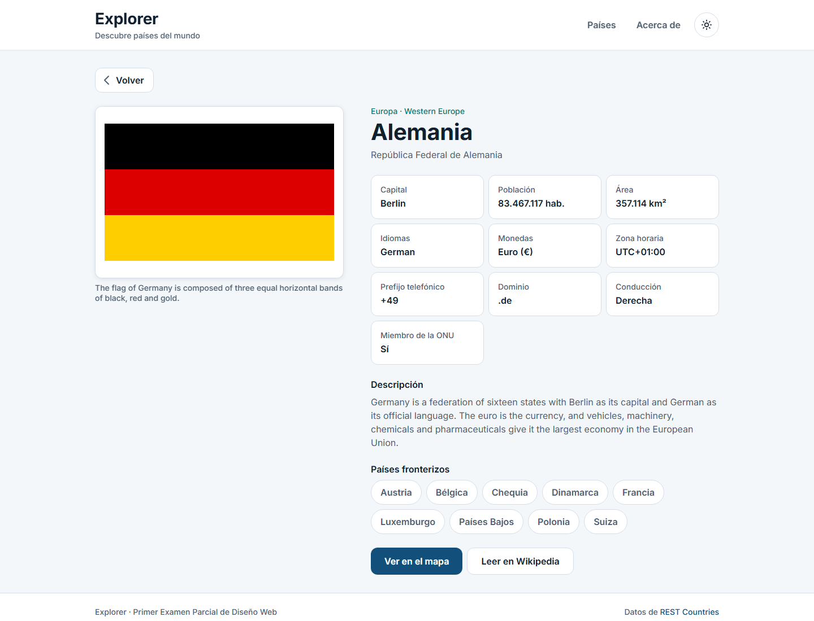 |

Modo oscuro:

| Mobile | Tablet | Desktop |
| --- | --- | --- |
| 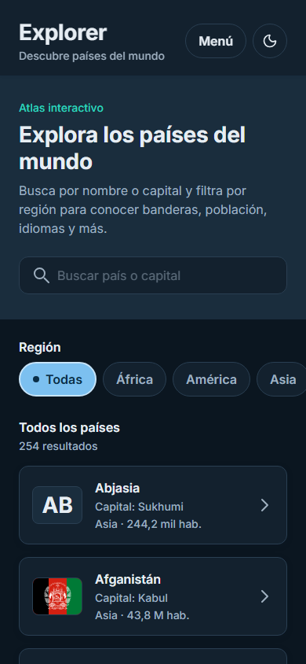 | 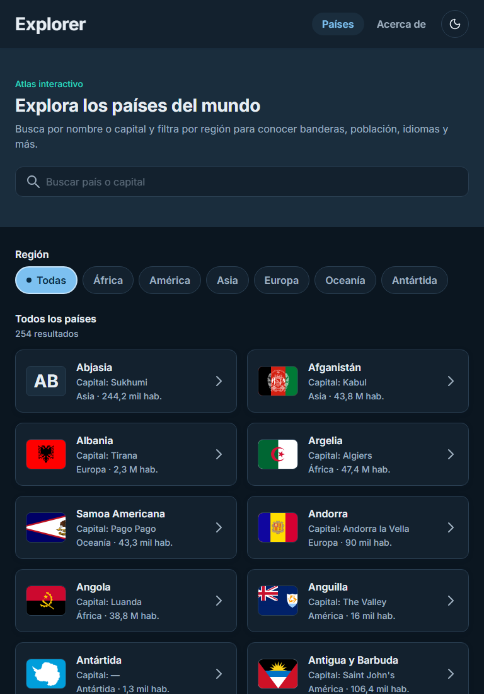 | 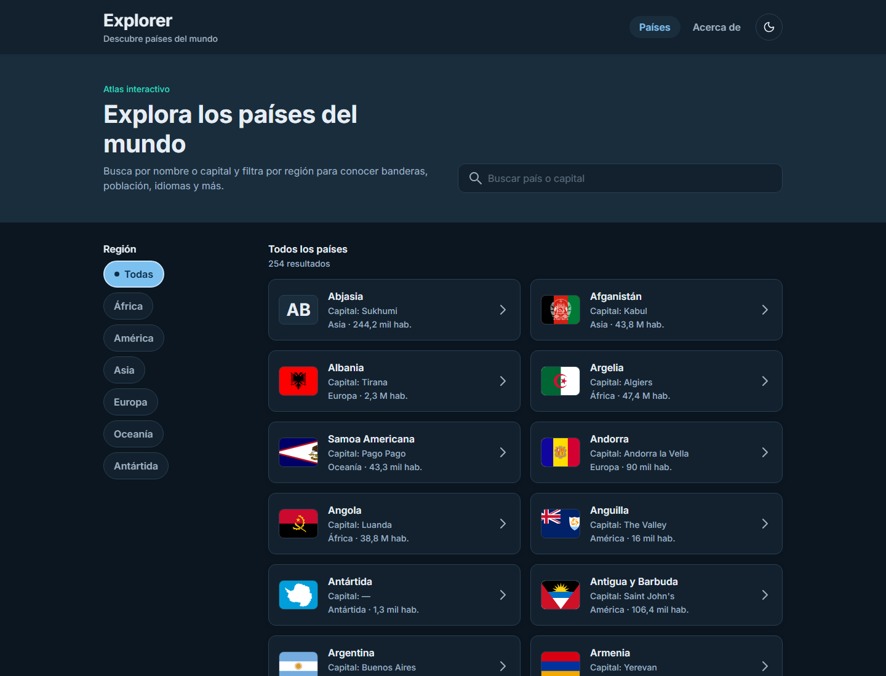 |
| 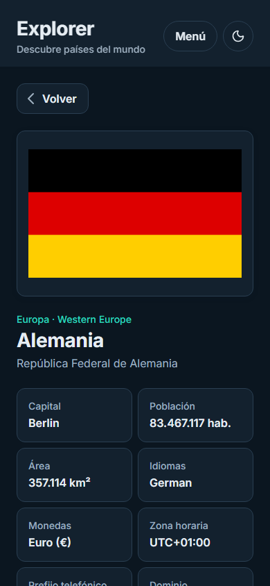 | 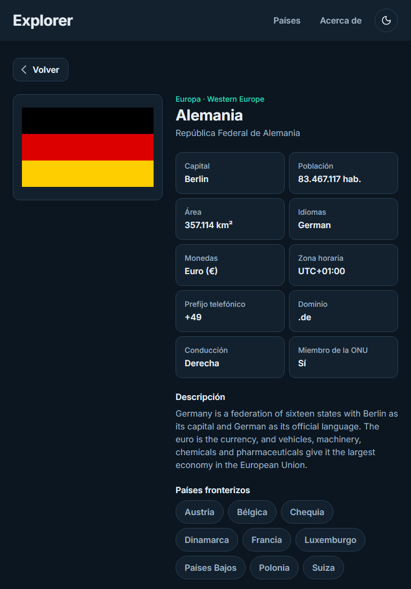 | 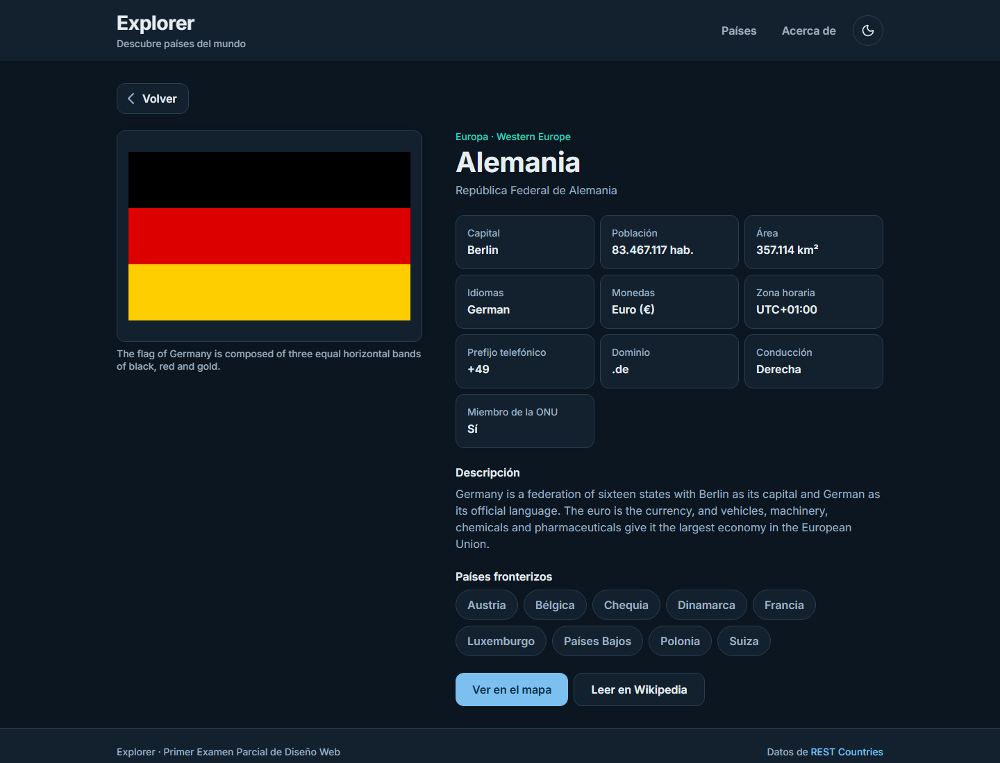 |

## Referencias de Figma

- Archivo: [Explorer App — UX/UI Lab 1](https://www.figma.com/design/DKwDIaYIAOFChHVtslngNh/Explorer-App-%E2%80%94-UX-UI-Lab-1)
- Imágenes exportadas para Desktop, Tablet y Mobile: [`docs/figma/`](docs/figma)
