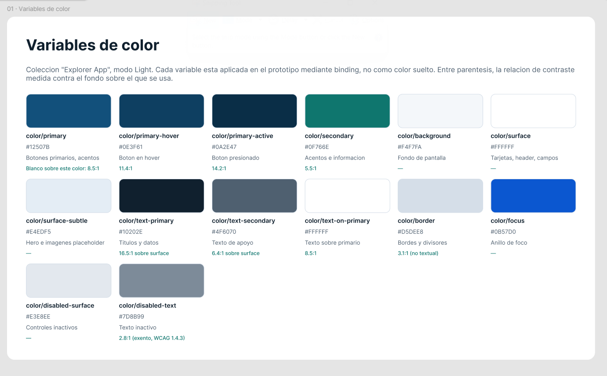
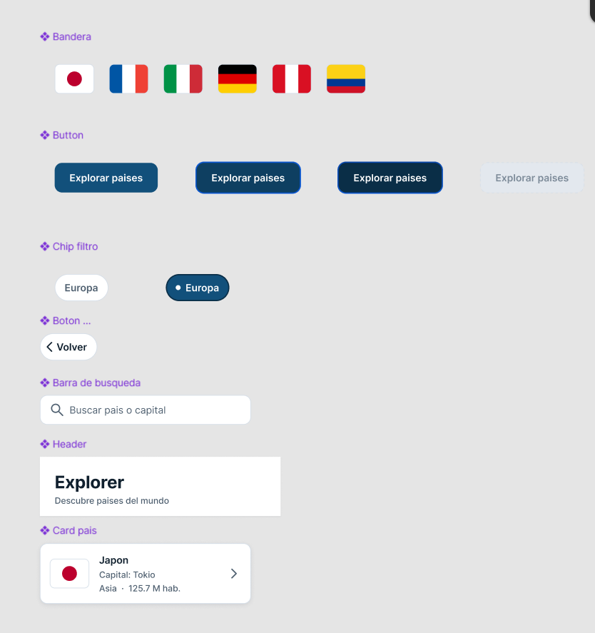
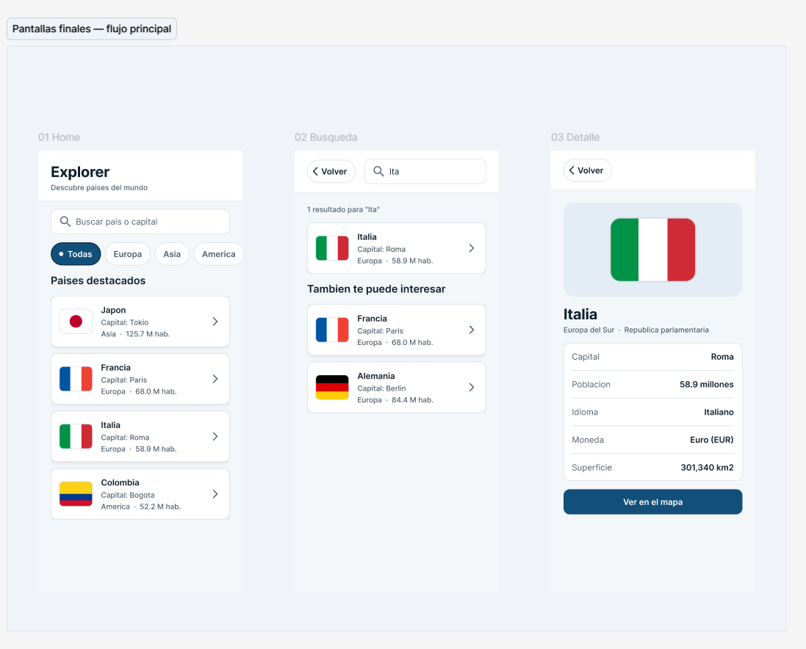
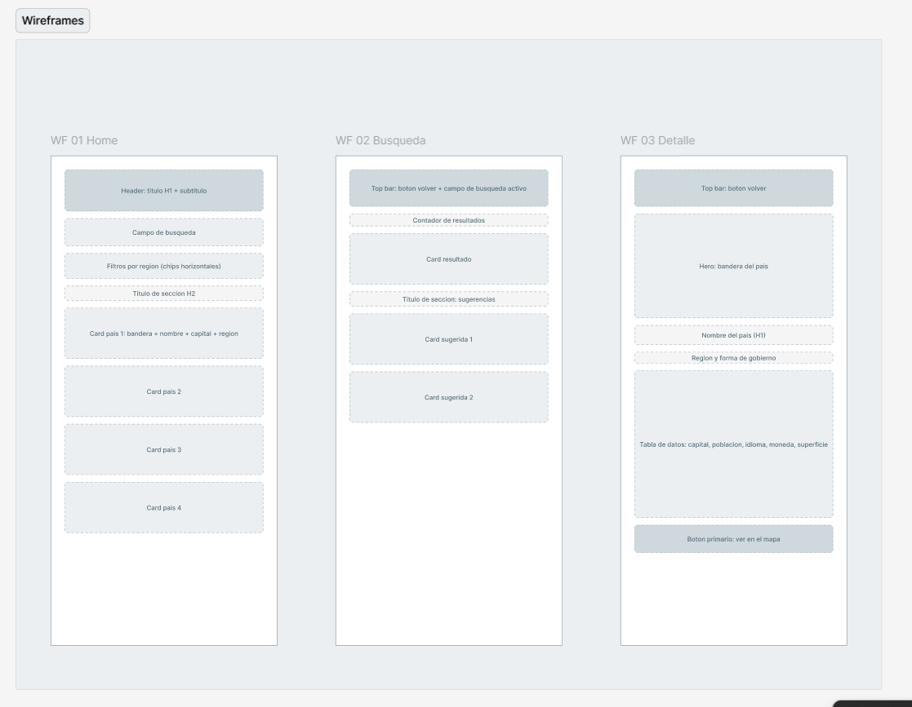
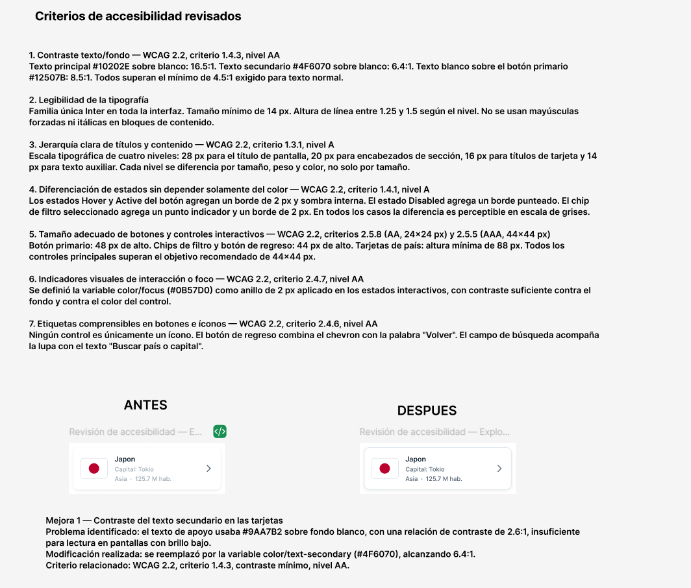

# Referencias de Figma

Exportaciones del archivo **Explorer App — UX/UI Lab 1**
(https://www.figma.com/design/DKwDIaYIAOFChHVtslngNh/Explorer-App-%E2%80%94-UX-UI-Lab-1).

| Archivo | Contenido |
| --- | --- |
| [`01-variables-de-color.png`](01-variables-de-color.png) | Colección de variables de color (modo Light) con su contraste |
| [`02-componentes.png`](02-componentes.png) | Componentes: Bandera, Button (estados), Chip filtro, Botón volver, Barra de búsqueda, Header y Card país |
| [`03-pantallas-mobile.png`](03-pantallas-mobile.png) | Pantallas finales del flujo principal: 01 Home, 02 Búsqueda, 03 Detalle |
| [`04-wireframes.png`](04-wireframes.png) | Wireframes de Home, Búsqueda y Detalle |
| [`05-accesibilidad.png`](05-accesibilidad.png) | Criterios de accesibilidad revisados (WCAG 2.2) y mejora antes / después |

## Variables de color

## Componentes

## Pantallas finales

## Wireframes

## Accesibilidad

